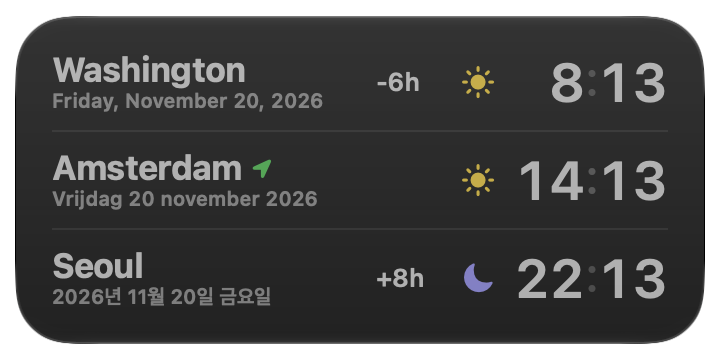
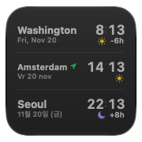

# Mushroom Clocks

A world-clock widget for macOS and Android. Each city gets a row with its
name, its date (in the language of its own country), a 24-hour time, a
time-of-day icon (sunrise, day, sunset, night) and its difference from your
own clock. A green arrow marks the cities on your time.

```
Washington                6:41
Fri, Nov 20           🌅  -6h
──────────────────────────────
Amsterdam ➤              12:41
Vr 20 nov              ☀  +0h
──────────────────────────────
Seoul                    20:41
11월 20일 (금)           ☾  +8h
```

| Folder     | Platform                  | Language |
|------------|---------------------------|----------|
| `macos/`   | macOS 14+ desktop widget  | Swift, SwiftUI, WidgetKit |
| `android/` | Android 12+ home-screen widget | Kotlin |

Both come with a small app for choosing the cities (up to 10) and options.

## Contents

- [macOS](#macos)
- [Android](#android)
  - [Energy use](#energy-use)
- [Layout](#layout)

## macOS

<p>
  
  &nbsp;
  
</p>

```sh
cd macos
./install.sh      # build, install into /Applications, and open the app
./build.sh        # or only build, into ./build
```

Requires Xcode. The app is signed ad hoc (no developer certificate), so it is
meant for your own Mac. Then add the widget from the desktop's widget gallery
(right-click the desktop → Edit Widgets → Mushroom Clocks), in small, medium
or large.

How it works:

- The digits are system-driven timer texts, so the widget ticks without the
  app redrawing it; the colon of your own city blinks.
- The cities and settings are JSON files in
  `~/Library/Application Support/MushroomClocks/`, written by the app and read
  by the sandboxed widget.
- The widget plans several days of timeline ahead, but macOS rejects a
  timeline archive above roughly 10 MB and then shows a blank widget. The
  provider estimates the archive size per entry, scaled by the widget's text
  size, and stops before a budget of 7 MB (see `Widget/ClocksWidget.swift`).

## Android

```sh
cd android
./gradlew assembleRelease     # app/build/outputs/apk/release/app-release.apk
./gradlew testDebugUnitTest   # unit tests for the time logic
adb install -r app/build/outputs/apk/release/app-release.apk
```

Requires JDK 17 and the Android SDK (`ANDROID_HOME`). Add the widget from the
app's "Add widget to home screen" button, or from the launcher's widget list.
It switches to a wide layout with full dates at about 250 dp wide.

The release build is signed with the debug key so it installs locally; sign
it with your own key before publishing.

### Energy use

The Android widget is built to cost as little battery as possible:

- **The launcher keeps the time.** Each time is a `TextClock` set to the
  city's zone, ticked by the launcher with its own clock. The app is never
  woken to move the time.
- **The app wakes a handful of times a day**: at a city's midnight (its date),
  at the hours the icons change (5:00, 8:00, 18:00, 20:00) and at daylight
  saving shifts. One non-waking `RTC` alarm is set at the next such moment;
  while the screen is off it waits. Time zone, clock, language, boot and app
  update broadcasts also refresh the widget. There is no periodic update.
- **No libraries**: platform APIs only, no AndroidX or Compose. The release
  APK is about 66 KB.

Trade-offs: the colon does not blink, seconds are off by default (they make
the launcher redraw every second), and a date or icon may change up to
10 minutes late, since Android stretches inexact alarm windows to 10 minutes.
The time itself is always exact.

## Layout

```
macos/
  App/        city editor app
  Widget/     WidgetKit provider and timeline
  Shared/     clock view, cities, time zone → country table
android/app/src/main/
  kotlin/dev/mushroom/clocks/
    ClocksWidget.kt   widget provider, layouts, alarm
    ClockTime.kt      offsets, icon phases, next change (unit tested)
    Cities.kt         city catalogue and storage
    Regions.kt        a zone's country and date language (ICU)
    MainActivity.kt   city editor
  res/                layouts, icons, colours
```
